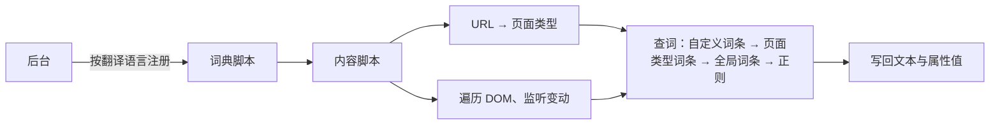

<div align="center">


# GitHub 中文化

把 GitHub 界面翻译成简体中文、繁体中文的浏览器扩展

[](https://github.com/setube/github-chinese/actions/workflows/release.yml)
[](https://github.com/setube/github-chinese/releases)
[](LICENSE)

<br />
[](https://chromewebstore.google.com/detail/github-chinese/bgjbinlidnenibphgepagdkodcohgibe)
[](https://microsoftedge.microsoft.com/addons/detail/ahhkmjnecgfpaegcfpolmlfijmldhmbk)
[](https://addons.mozilla.org/zh-CN/firefox/addon/github-chinese/)
[](#safarimacos)

[安装](#安装) · [功能](#功能) · [使用](#使用) · [工作原理](#工作原理) · [隐私与权限](#隐私与权限) · [参与贡献](#参与贡献) · [反馈问题](https://github.com/setube/github-chinese/issues/new/choose)

</div>

---

在 github.com、gist.github.com、www.githubstatus.com 上把界面文字替换为简体中文或繁体中文，翻译在本地完成。

只翻译界面，不碰用户内容：自述文件、评论、代码、提交消息、存储库名、用户名、自定义标签名等保持原文。

| 英文界面      | 简体中文 | 繁體中文 |
| ------------- | -------- | -------- |
| Pull requests | 拉取请求 | 拉取請求 |
| Issues        | 议题     | 議題     |
| Actions       | 操作     | 動作     |
| Releases      | 发行版   | 發行版本 |
| Fork          | 复刻     | 分叉     |
| Star          | 星标     | 加星號   |

## 功能

### 翻译

- 简体、繁体两套词典，各 3 万余条，词条按页面类型（存储库、议题、拉取请求、操作、设置等）区分
- 繁体按台湾、香港、澳门用语从英文翻译，不是简繁转换；术语见[简体术语表](docs/GLOSSARY.md)、[繁体术语表](docs/GLOSSARY.zh-TW.md)
- 跟随 GitHub 的 React 渲染与页面切换实时翻译，文字被改写后自动重新翻译
- 属性（`aria-label`、`placeholder`、`title` 等）与标签页标题一并翻译
- 时间本地化：`<relative-time>` 按翻译语言显示为「3 天前」「2026 年 10 月 26 日」

### 加速

- 下载：Release 附件、源码包（zip、tar.gz，含 codeload）、Raw 文件、代码片段的压缩包与 Raw 文件，改走第三方加速源
- 克隆：存储库与代码片段的 HTTPS 克隆地址换成加速后的地址
- 图片：头像、GitHub 静态图片、Raw 图片加载失败时，经加速源重新获取
- 默认关闭；故障转移：首选连不上时换用其他加速源，都连不上时直接从 GitHub 获取
- 加速源可自定义、删除、测速（延迟、Ping）

### 搜索净化

- 搜索结果中命中屏蔽规则的结果直接隐藏，不留占位、不提示
- 规则按所有者、存储库、关键词填写；默认没有规则

### 控制

- 弹出页：总开关、当前页状态、排除此页、时间本地化、翻译标题、加速下载、净化搜索、界面语言、翻译语言、外观
- 设置页（弹出页「设置」）分三个标签页：汉化设置（排除路径、自定义词条及其导入导出）、加速设置（加速开关、加速源）、净化设置（净化搜索开关、屏蔽规则）；改动即时保存
- 翻译语言默认按浏览器语言识别（语言列表中第一个中文：台湾、香港、澳门及 Hant 为繁体；没有中文时按时区），可手动指定；切换后已打开的页面随即重译
- 扩展界面：简体中文、繁體中文、English，默认跟随浏览器界面语言
- 外观：自动（跟随系统）、浅色、深色

## 安装

### 从扩展商店安装

| 浏览器  | 商店                                                                                                        |
| ------- | ----------------------------------------------------------------------------------------------------------- |
| Chrome  | [Chrome 应用商店](https://chromewebstore.google.com/detail/github-chinese/bgjbinlidnenibphgepagdkodcohgibe) |
| Edge    | [Microsoft Edge 加载项](https://microsoftedge.microsoft.com/addons/detail/ahhkmjnecgfpaegcfpolmlfijmldhmbk) |
| Firefox | [Firefox 附加组件](https://addons.mozilla.org/zh-CN/firefox/addon/github-chinese/)                          |

### 从发行版安装

在[发行版](https://github.com/setube/github-chinese/releases)页面下载：

| 浏览器  | 文件                                | 安装                                                                                                                   |
| ------- | ----------------------------------- | ---------------------------------------------------------------------------------------------------------------------- |
| Chrome  | `github-chinese-<版本>-chrome.zip`  | 解压 → `chrome://extensions` → 开启「开发者模式」→「加载已解压的扩展程序」→ 选择解压出的文件夹                         |
| Edge    | `github-chinese-<版本>-edge.zip`    | 解压 → `edge://extensions` → 开启「开发人员模式」→「加载解压缩的扩展」→ 选择解压出的文件夹                             |
| Firefox | `github-chinese-<版本>-firefox.xpi` | 已签名：用 Firefox 打开即安装。未签名：`about:debugging#/runtime/this-firefox` →「临时载入附加组件」，重启浏览器后失效 |

- `.crx` 用于企业策略部署；Chrome、Edge 一般不允许直接安装商店之外的 crx。
- 校验：`sha256sum -c --ignore-missing SHA256SUMS.txt`

### Safari（macOS）

未上架 App Store；宿主应用未签名、未经公证。需要 macOS 13+、Safari 18+。

1. 下载 `github-chinese-<版本>-safari-macos.zip`，解压，把「GitHub Chinese.app」移到「应用程序」。
2. 解除隔离（未公证的应用默认打不开）：

   ```bash
   xattr -dr com.apple.quarantine "/Applications/GitHub Chinese.app"
   ```

3. 打开「GitHub Chinese」一次，扩展随之注册到 Safari。
4. Safari「设置」→「高级」→ 勾选「显示网页开发者功能」；「开发者」→ 勾选「允许未签名的扩展」。
5. 「设置」→「扩展」→ 勾选「GitHub 中文化」；「编辑网站…」中允许 github.com、gist.github.com、www.githubstatus.com。

- 「允许未签名的扩展」在退出 Safari 后失效，每次启动 Safari 需重新勾选。
- 更新：用新版替换「应用程序」中的旧版，重做第 2、3 步。

### 从源码构建

环境：Bun 1.3+、Node.js 22.13+（LTS 版本）。

```bash
git clone https://github.com/setube/github-chinese.git
cd github-chinese
bun install
bun run build           # Chrome → .output/chrome-mv3
bun run build:edge      # Edge → .output/edge-mv3
bun run build:firefox   # Firefox → .output/firefox-mv3
bun run build:safari    # Safari → .output/safari-mv3
bun run pack:safari     # 由 .output/safari-mv3 打包宿主应用（macOS，需 Xcode）→ .output/github-chinese-<版本>-safari-macos.zip
```

加载方式同上表（不用解压）；Firefox 临时载入 `.output/firefox-mv3/manifest.json`。

## 使用

安装后立即生效，已打开的 GitHub 页面无需刷新。

### 弹出页状态

| 状态   | 含义                   | 按钮     |
| ------ | ---------------------- | -------- |
| 已翻译 | 当前页已翻译           | 排除此页 |
| 已排除 | 当前页命中排除规则     | 取消排除 |
| 已停用 | 总开关关闭             | —        |
| 未就绪 | 页面里的脚本未响应     | 刷新     |
| 未授权 | 站点权限已撤销         | 授权     |
| 不可用 | 当前页不是 GitHub 页面 | —        |

### 排除路径

弹出页「排除此页」加入当前页的路径；设置页「汉化设置」中逐条添加、修改、删除。

每条以 `/` 开头，不区分大小写；`*` 匹配一段，`**` 匹配任意多段；同时排除下级路径。

```text
/settings        设置页及其下级页面
/*/*/wiki        所有存储库的维基
```

- 只停止翻译；加速、搜索净化照常。
- 弹出页「取消排除」删除命中当前页的全部规则，含通配规则。

### 自定义词条

设置页「汉化设置」中添加、搜索、修改、删除。原文 → 译文，优先于内置词条。导入、导出格式为 JSON：`{ "原文": "译文" }`；导入时同一原文以导入的为准。

### 加速

「加速下载」（弹出页、设置页）管下载与克隆；设置页「加速设置」另有「加速图片」「故障转移」开关与加速源列表：选首选、测速、添加、删除，「恢复内置」找回删除的内置源。

- 下载：单击下载链接时改开加速源的地址；中键、带修饰键的单击照常从 GitHub 打开。
- 克隆：存储库「Code」下拉框与代码片段的 HTTPS 克隆地址显示为加速后的地址，复制按钮复制加速后的地址。新建存储库页面中的地址不改。
- 图片：开启「加速图片」后，头像、GitHub 静态图片、Raw 图片加载失败时由后台经加速源获取，换成 `data:` 地址显示。
- 私有、内部存储库与私密代码片段的页面不加速。
- 页面的 CSS、JS 不加速：GitHub 的内容安全策略只允许从 `github.githubassets.com` 加载脚本与样式，换地址或重定向都会被浏览器拦截。

加速源地址只接受 `https`：`{url}` 换成原链接，`{path}` 换成 github.com 上的路径；都不写时原链接接在地址之后。

```text
https://ghfast.top/{url}        https://ghfast.top/https://github.com/<所有者>/<存储库>/releases/download/…
https://mirror.example/{path}   https://mirror.example/<所有者>/<存储库>/releases/download/…
https://ghfast.top              同第一行
```

- 用 `{path}` 的加速源只加速 github.com 上的地址。各内置加速源支持的地址不同，首选不支持时用列表中下一个支持的。
- 延迟：首次请求的耗时，含建立连接；Ping：连接建立后再请求 3 次的中位数。浏览器发不了 ICMP，两者都按 HTTP 请求计时。
- 内置加速源是第三方公益服务，可用性随时变化。加速源能看到下载地址与你的 IP 地址，也能改动下载的文件。
- 用加速地址克隆的存储库，远程地址指向加速源，推送时凭据会发给加速源。推送前改回 GitHub：`git remote set-url origin https://github.com/<所有者>/<存储库>.git`。

### 搜索净化

设置页「净化设置」中逐条添加、修改、删除，不区分大小写：

```text
@octocat               所有者：其存储库、存储库下的议题与代码等结果，以及该用户本身
octocat/hello-world    存储库
hello world            关键词：名称、标题、描述、主题、标签含这段文字
```

- GitHub 地址按所有者、存储库识别，存为上面的写法：`https://github.com/octocat`、`https://github.com/octocat/hello-world/issues`。
- 其余写法都按关键词。不带 `@` 的用户名也是关键词，会命中名称里含它的其他结果。以 `@` 开头、写成「所有者/存储库」的关键词加引号：`"@octocat"`。
- 指向同一所有者、存储库或关键词（关键词加不加引号）的规则不重复添加。
- 只处理 github.com 的搜索结果页。结果数、分页不变；一页全部命中时该页为空。
- 总开关或「净化搜索」（弹出页、设置页）关闭后不再隐藏。改规则、开关后已打开的搜索页随即更新，无需刷新。

## 工作原理



- **词典脚本**：每种翻译语言一个，只加载当前语言的。后台把它注册为 `document_start` 内容脚本，页面开始解析前就绪；未注册时（如刚安装）由内容脚本动态导入，Firefox、Safari 请后台注入。
- **与 React 共存**：只改文本节点的内容与属性值，不增删、替换节点；React 重渲染写回英文时，以新内容为原文重新翻译。
- **跳过用户内容**：用户内容、代码所在的区域整体跳过。
- **时间本地化**：`<relative-time>` 等时间元素按翻译语言渲染，再补中文与数字间的空格、去掉时区名。
- **搜索净化**：随页面变动逐条检查搜索结果，命中规则的结果改行内 `display`，不删节点；变动回调在绘制前执行，命中的结果不会先显示再消失。

## 浏览器支持

| 浏览器          | 版本                    |
| --------------- | ----------------------- |
| Chrome、Edge    | 支持 Manifest V3 的版本 |
| Firefox         | 140+                    |
| Firefox Android | 142+                    |
| Safari（macOS） | 18+                     |

## 隐私与权限

翻译、搜索净化在本地完成，不向开发者发送数据。开启加速后，下载链接、克隆地址、加载失败的图片地址交给你选的第三方加速源。详见[隐私说明](docs/PRIVACY.md)。

| 权限                                                                                  | 用途                                                                                                                                                                                              |
| ------------------------------------------------------------------------------------- | ------------------------------------------------------------------------------------------------------------------------------------------------------------------------------------------------- |
| `storage`                                                                             | 保存设置（`storage.sync`）、自定义词条与屏蔽规则（`storage.local`）                                                                                                                               |
| `https://github.com/*`、`https://gist.github.com/*`、`https://www.githubstatus.com/*` | 在这三个站点运行内容脚本，翻译页面界面                                                                                                                                                            |
| `scripting`                                                                           | 按当前语言注册词典脚本，页面开始解析前就绪；词典脚本动态加载失败（Firefox、Safari 不动态加载）时由后台注入；Chrome、Edge、Safari 安装、更新后向已打开的 GitHub 标签页注入脚本（Firefox 自动注入） |

- 不申请其他权限。Firefox 中可在附加组件管理器撤销站点权限，撤销后弹出页显示「未授权」，点「授权」恢复。Safari 中站点权限在「设置」→「扩展」中授予、撤销。
- 停用、排除、改自定义词条、改时间本地化开关、扩展更新或卸载时，以及 GitHub 从自身缓存写回译文时（前进后退、帧导航到带锚点的地址），可能重新请求当前 GitHub 页面（条件见隐私说明）；点弹出页「刷新」时重新加载当前页。开启加速后：单击下载链接时打开加速源的地址；开启「加速图片」时，图片加载失败后由后台经加速源请求该图片；故障转移开启时，打开下载链接、换克隆地址前请求加速源站点的根路径探测能否连通；设置页「测速」时请求各加速源站点的根路径。不发起其他网络请求。
- 设置存 `storage.sync`，可能随浏览器账号同步（Safari 不同步）；自定义词条、屏蔽规则存 `storage.local`。

## 参与贡献

- 反馈：[新建议题](https://github.com/setube/github-chinese/issues/new/choose)，选「翻译问题」「缺陷报告」或「功能建议」模板。
- 改进译文：先读[术语表](docs/GLOSSARY.md)；改动简体词典后同步繁体。
- 提交前运行以下检查（同[发布工作流](.github/workflows/release.yml)）：

```bash
bun run lint
bun run compile
bun run check:parity
bun run check:locale
bun run check:locale --locale=zh-TW
bun run test
```

### 常用命令

| 命令                                                                        | 说明                                                                               |
| --------------------------------------------------------------------------- | ---------------------------------------------------------------------------------- |
| `bun run dev`、`dev:edge`、`dev:firefox`                                    | 开发模式，修改后自动重载                                                           |
| `bun run build`、`build:edge`、`build:firefox`、`build:safari`、`build:all` | 构建到 `.output/<浏览器>-mv3/`                                                     |
| `bun run zip`、`zip:edge`、`zip:firefox`、`zip:all`                         | 打包 zip 到 `.output/`（Firefox 另出源码包）                                       |
| `bun run pack:crx`                                                          | 由 zip 打包 crx                                                                    |
| `bun run pack:safari`                                                       | 由 Safari 版打包宿主应用（macOS，需 Xcode）                                        |
| `bun run test`、`test:watch`、`coverage`                                    | 单元测试（Vitest）、监听模式、覆盖率                                               |
| `bun run test:e2e`、`test:e2e:live`                                         | 端到端测试（Playwright）、线上冒烟，均先构建                                       |
| `bun run compile`、`lint`、`lint:firefox`、`format`                         | 类型检查（vue-tsc）、ESLint、web-ext lint、Prettier                                |
| `bun run check:locale`、`check:parity`                                      | 词典自检、简繁对照                                                                 |
| `bun run harvest`、`coverage:locale`                                        | 采集界面文本、统计词典覆盖率                                                       |
| `bun run icons`                                                             | 由 `assets/icon.svg` 生成 `public/icon/*.png`（内嵌位图超过 512px 时先压缩并写回） |

`bun test`、`bun build` 是 Bun 自带命令，本项目脚本一律用 `bun run`。

<details>
<summary><b>词典维护</b></summary>

1. 先读[术语表](docs/GLOSSARY.md)：翻译原则、格式、术语表、词典写法。术语参照 GitHub 官方中文文档与 Pro Git 中文版；社区词库 [maboloshi/github-chinese](https://github.com/maboloshi/github-chinese)（GPL-3.0）只用于发现漏收的原文，不搬运译文。
2. 简体词典在 `src/locales/zh-CN/`，繁体词典在 `src/locales/zh-TW/`（同名文件、同键同结构，译文按[繁体术语表](docs/GLOSSARY.zh-TW.md)从英文翻译），按页面类型分文件（`static` / `scoped` / `regexp` / `ignore` / `attributeRules` / `inline` / `mergeText`，字段说明见 `src/core/types.ts`），由 `index.ts` 注册。较大的组拆成子目录 `<组>/<名>.ts`，由 `<组>.ts` 用 `mergeDictionaries` 合并；子目录里没有默认导出的模块是共用工具。
3. 自检：`bun run check:locale src/locales/zh-CN/<文件>.ts`；不带文件时检查全部词典（含子文件），另查 static 冲突、同一页面类型的 scoped 冲突、未合并的子文件、未注册的主文件；加 `--redundant` 列出可删的 scoped（全局 static 已有相同译文）。繁体加 `--locale=zh-TW`（给出 `src/locales/zh-TW/` 下的文件时可省略），另扫描源码里所有含中文的字符串与模板字面量（含替换函数、模块内常量、helpers.ts 与 `src/locales/shared/`；注释与抛出的错误信息除外）：简体字报错，大陆用语与弯引号警告。改动简体词典后同步繁体，`bun run check:parity [文件...]` 逐项对照两边的键、正则、属性规则、行内句、导出与注册顺序。
4. 采集界面文本：`bun run harvest [--areas issues,pulls]`，按 `scripts/harvest-urls.json` 访问公开页面（未登录），输出 `.harvest/raw/<区域>.json`。访问要克制，避免触发限流。
5. 统计覆盖率：`bun run coverage:locale [--raw <目录>]... [--all] [--unused]`，输出 `.harvest/digest/<区域>.txt`（未翻译文本，按出现页面数排序）与 `coverage.json`；页面类型按当前路由规则重新判断，相邻文本节点与引擎一样先整组匹配、未命中再逐段统计（需用新版 harvest 采集的数据）。`--unused` 另输出 `unused.txt`：采集页面上从未用到的词条，可能已过时，删除前人工核对。
6. 正则规则写单元测试：`tests/unit/locales/<区域>.test.ts`。

</details>

<details>
<summary><b>测试</b></summary>

```bash
bun run test            # 单元测试（Vitest）
bun run coverage        # 单元测试覆盖率
bun run test:e2e        # 构建后运行端到端测试（Playwright 加载 .output/chrome-mv3）
bun run test:e2e:live   # 线上冒烟：访问 github.com/vuejs/core，截图存 test-results/
```

端到端测试首次运行前安装浏览器：`bunx playwright install chromium`。

- 离线测试：`github.com` 请求由 `tests/e2e/fixtures/` 中仿 GitHub 结构的页面应答，覆盖界面翻译、用户内容保持原文、属性、动态插入与 React 改写、忽略区域内的界面块（评论中的建议块、应用权限选择器）、`<relative-time>`、标题、设置联动（总开关、排除路径、自定义词条，含后台休眠后）、弹出页。
- 线上冒烟仅在环境变量 `E2E_LIVE=1` 时执行，`bun run test:e2e:live` 已自动设置。
- 报告：`playwright-report/`；失败时的 trace 与截图：`test-results/`。

</details>

<details>
<summary><b>目录结构</b></summary>

```text
.github/                 议题模板、发布工作流
assets/icon.svg          图标源文件
docs/GLOSSARY.md         翻译规范与术语表
docs/GLOSSARY.zh-TW.md   繁体翻译规范与术语表
docs/PRIVACY.md          隐私说明
public/_locales/         扩展名称、说明的多语言文本
public/icon/             扩展图标（bun run icons 生成）
scripts/                 采集、覆盖率、词典校验、图标渲染、crx 与 Safari 打包脚本
scripts/safari-app/      Safari 宿主应用的页面
src/
  core/                  匹配器、URL → 页面类型、忽略规则、翻译引擎、加速、搜索净化
  locales/zh-CN/         简体中文词典
  locales/zh-TW/         繁体中文词典（与简体同结构）
  locales/shared/        简繁共用的时间、拼接工具
  i18n/                  扩展界面文案（简体、繁体、英文）
  shared/                设置存储、消息协议等共用模块
  components/            弹出页与设置页共用组件
  components/ui/         基础控件：按钮（含水波纹）、输入框、下拉框、开关、标签页
  entrypoints/           background、content、词典脚本、popup、options
tests/
  unit/                  单元测试
  e2e/                   端到端测试与离线夹具
wxt.config.ts            WXT 配置与 manifest
```

</details>

## 发布

推送标签 `v<版本>`（与 `package.json` 的 `version` 一致）后，[发布工作流](.github/workflows/release.yml)依次检查（lint、类型、词典、单元测试）、打包，并发布 GitHub 发行版（先建草稿，产物传完后发布）；Safari 版同时在 macOS 上打包，打包失败时发行版不含 Safari 版；版本号带 `-`（如 `v1.0.0-beta.1`）时为预发行版。在存储库的「操作」页手动运行时只检查、打包，产物在运行记录的工件里。

| 产物                                                | 说明                                                    |
| --------------------------------------------------- | ------------------------------------------------------- |
| `github-chinese-<版本>-chrome.zip`、`-edge.zip`     | Chrome、Edge 扩展包（上架商店用）                       |
| `github-chinese-<版本>-firefox.zip`、`-sources.zip` | Firefox 扩展包、源码包（AMO 审核用）                    |
| `github-chinese-<版本>-chrome.crx`、`-edge.crx`     | CRX3 扩展包                                             |
| `github-chinese-<版本>-firefox.xpi`                 | Firefox 扩展包                                          |
| `github-chinese-<版本>-safari-macos.zip`            | Safari 宿主应用（未签名、未公证）                       |
| `SHA256SUMS.txt`                                    | 以上文件的 SHA-256，校验：`sha256sum -c SHA256SUMS.txt` |

<details>
<summary><b>存储库机密与签名</b></summary>

| 机密                               | 用途                                                                                                     | 未配置时                     |
| ---------------------------------- | -------------------------------------------------------------------------------------------------------- | ---------------------------- |
| `CRX_PRIVATE_KEY`                  | crx 签名私钥（RSA PEM），决定扩展 ID                                                                     | 用临时私钥，扩展 ID 每次不同 |
| `AMO_JWT_ISSUER`、`AMO_JWT_SECRET` | [AMO API 密钥](https://addons.mozilla.org/developers/addon/api/key/)，以自行分发（unlisted）方式签名 xpi | xpi 未签名                   |

- 生成私钥：`openssl genpkey -algorithm RSA -pkeyopt rsa_keygen_bits:2048 -out crx-key.pem`，文件内容填入 `CRX_PRIVATE_KEY`。私钥不提交到存储库（`.gitignore` 已忽略 `*.pem`）；更换私钥后扩展 ID 随之改变。
- 本地打包 crx：`bun run pack:crx --key crx-key.pem .output/github-chinese-<版本>-chrome.zip`，在 zip 旁生成同名 `.crx`；不带 `--key` 时读环境变量 `CRX_PRIVATE_KEY`。
- xpi 只在推送正式版标签时签名；手动运行、预发行版（Firefox 的版本号去掉 `-` 之后的部分，签名会占用正式版的版本号）产出未签名 xpi。
- AMO 上同一版本号只能提交一次：签名包下载后立即存进发行版草稿，重跑时沿用；以 unlisted 签名过的版本，不能再以同一版本号上架（listed）。

</details>

## 常见问题

### 有些文字没有翻译？

用户内容不翻译。界面文字未翻译时，用「翻译问题」模板反馈。

### 繁体是简繁转换吗？

不是。繁体词典按台湾、香港、澳门用语从英文翻译，见[繁体术语表](docs/GLOSSARY.zh-TW.md)。

### 只在部分页面关闭？

弹出页「排除此页」，或在设置页「汉化设置」添加排除路径。

### 搜索结果比 GitHub 显示的少？

命中屏蔽规则的结果被隐藏，不提示。关闭「净化搜索」或删除对应规则后恢复。

## 致谢

- 术语参照 [GitHub 官方中文文档](https://docs.github.com/zh)与 [Pro Git 中文版](https://git-scm.com/book/zh/v2)
- [maboloshi/github-chinese](https://github.com/maboloshi/github-chinese)：用于发现漏收的原文，不搬运译文
- [BonjourFeng/Github-Search-Purification](https://github.com/BonjourFeng/Github-Search-Purification)：搜索净化参考其思路，不搬运代码与屏蔽名单
- 基于 [WXT](https://wxt.dev)、[Vue](https://vuejs.org) 构建

## 许可证

[MIT](LICENSE) © 2026 github-chinese contributors

## LINUX DO社区

感谢[Linux.do](https://linux.do/)社区的支持。
